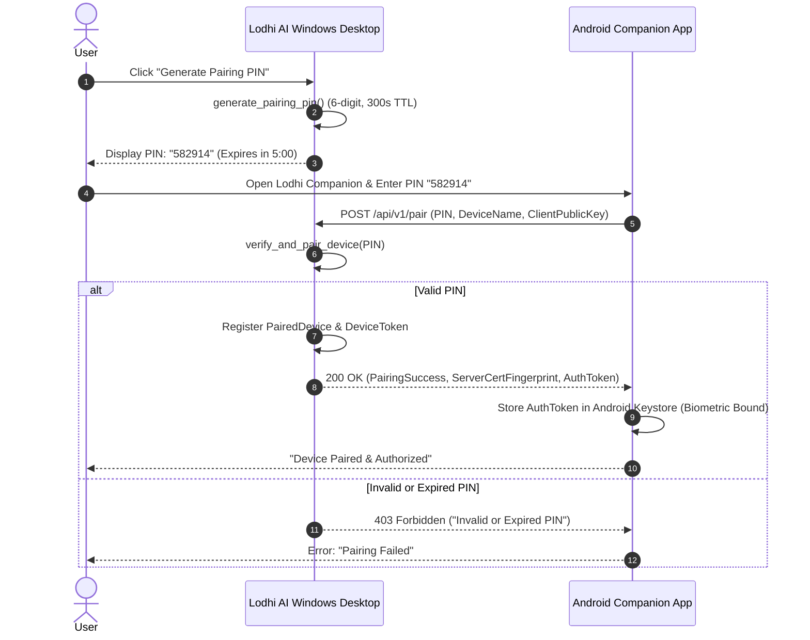

# Lodhi AI — Android Companion Foundation & Synchronization Specification

**Version:** 1.0.0 (Phase 3 Foundation)  
**Target Platform:** Android 11+ (API Level 30+)  
**Communication Protocol:** Local LAN WebSocket / TLS REST with Cryptographic PIN Handshake  

---

## 1. Overview & Objectives

The Lodhi AI Android Companion provides an encrypted, local-first bridge between the Lodhi AI Windows Desktop application and mobile Android devices.

Key objectives:
1. **Zero Cloud Requirement:** Sync occurs directly over local Wi-Fi / LAN via mutual cryptographic verification.
2. **Secure One-Time Handshake:** 6-digit cryptographically generated PIN displayed on desktop with 5-minute expiry.
3. **Task Monitoring & Approval on Mobile:** Review, authorize, or cancel long-running developer agent tasks from your phone.
4. **Offline Resilience:** Store-and-forward architecture with automatic reconnect backoff.

---

## 2. Cryptographic Pairing Protocol



---

## 3. OpenAPI 3.1 Synchronous Contract

### `POST /api/v1/pair`
- **Request:**
  ```json
  {
    "submittedPin": "582914",
    "deviceName": "Pixel 8 Pro",
    "deviceModel": "Google Pixel",
    "clientIp": "192.168.1.105"
  }
  ```
- **Response (200 OK):**
  ```json
  {
    "id": "device-1729600000000-1",
    "name": "Pixel 8 Pro",
    "model": "Google Pixel",
    "ipAddress": "192.168.1.105",
    "pairedAtMs": 1729600000000,
    "lastSeenMs": 1729600000000,
    "authorized": true,
    "publicKeyFingerprint": "SHA256:a5b4c3d2e1f0..."
  }
  ```

### `GET /api/v1/sync`
- **Headers:** `Authorization: Bearer <AuthToken>`
- **Response (200 OK):**
  ```json
  {
    "syncId": "sync-1729600010000",
    "serverTimeMs": 1729600010000,
    "status": "synchronized",
    "tasksCount": 3,
    "conversationsCount": 12,
    "offlineQueueCount": 0
  }
  ```

### `POST /api/v1/task/action`
- **Headers:** `Authorization: Bearer <AuthToken>`
- **Request:**
  ```json
  {
    "taskId": "task-1729600000000-0",
    "decision": "approve" | "deny" | "abort",
    "biometricVerified": true
  }
  ```

---

## 4. Mobile Security & Storage Standards

1. **Android Keystore Encryption:**
   - Companion auth tokens and cryptographic identity keys are stored using the Android Keystore system with `MasterKey.DEFAULT_MASTER_KEY_ALIAS` (`AES256_GCM`).
2. **Biometric Authorization Gate:**
   - Any sensitive operation dispatched from the Android phone (such as approving a write to disk or executing a shell script) mandates successful `BiometricPrompt` authentication on Android.
3. **Revocation & Instant Termination:**
   - When a device is revoked from the desktop via `revoke_paired_device()`, subsequent sync requests immediately fail with `401 Unauthorized` and the companion session is invalidated.

---

## 5. Offline Queueing & Network Failure Behavior

- When the mobile device leaves Wi-Fi range or disconnects from the desktop host:
  1. The companion app transitions to **Offline Mode**.
  2. Local prompt drafts or task review comments are stored in an encrypted Room SQLite database queue.
  3. Reconnection uses exponential backoff (`1s, 2s, 4s, 8s, max 30s`).
  4. Upon reconnection, queued items are replayed in timestamp sequence.
