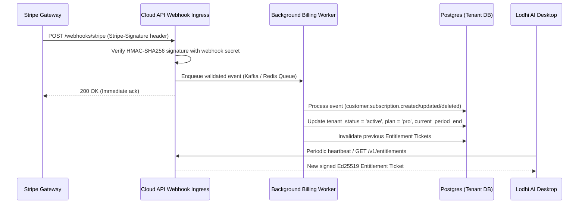
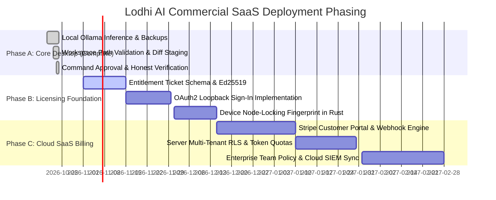

# Lodhi AI — Commercial SaaS Roadmap & Security Review

**Document Version:** 1.0.0  
**Target Architecture:** Hybrid Edge-Desktop Client (Tauri/Rust) with Enterprise Multi-Tenant Cloud Control Plane  
**Security Baseline:** Least Privilege · Zero-Trust Client · Defense in Depth · Air-Gapped Local Autonomy  

---

## 1. Executive Summary & Architectural Scope

Lodhi AI is architected as an **offline-first, privacy-guaranteeing developer platform** running natively on Windows desktop. While the current desktop application functions autonomously with local Ollama (`qwen2.5-coder:3b`) and client-side workspace safeguards, transitioning to a commercial SaaS requires a robust, zero-trust cloud control plane without compromising offline capability.

### Fundamental Security Mandates:
1. **Never Trust the Client:** Desktop client binaries can be inspected, decompiled, or patched. Client-side entitlement checks, license flags, and payment notifications must never be accepted as authoritative. All monetization and quota enforcement must be verified server-side.
2. **Zero Payment Credentials on Client:** Credit card details, Stripe/Paddle secret keys, webhook secrets, and billing management credentials must never touch the desktop client or be stored locally.
3. **No Phantom Production Claims:** The desktop app currently operates in **Free Community Edition** mode with local offline capabilities. SaaS billing, remote authentication, and multi-tenant quotas are designed below as an actionable implementation roadmap.

---

## 2. Customer Registration & Identity Federation

### 2.1 Authentication Architecture
- **Protocol:** OpenID Connect (OIDC) / OAuth 2.0 with PKCE (Proof Key for Code Exchange, RFC 7636).
- **Desktop Sign-in Flow (Loopback Redirect):**
  1. User clicks **"Sign In / Link Account"** in Lodhi AI Desktop Settings.
  2. Lodhi AI Rust core generates a cryptographically secure random `code_verifier` (high-entropy cryptographic random string) and computes `code_challenge = SHA256(code_verifier)`.
  3. A temporary local loopback HTTP server is spawned on a random available port on `127.0.0.1` (e.g., `http://127.0.0.1:49152/callback`).
  4. The desktop app launches the system default browser navigating to:
     `https://auth.lodhiai.com/authorize?response_type=code&client_id=lodhi-desktop&redirect_uri=http://127.0.0.1:49152/callback&code_challenge=<challenge>&code_challenge_method=S256&scope=openid profile email`
  5. Upon successful user authentication (Email/Password, GitHub, Google, or Passkey/WebAuthn), the browser redirects back to the loopback server with an authorization code.
  6. Rust core exchanges the authorization code + `code_verifier` directly with `https://auth.lodhiai.com/oauth/token` via TLS 1.3.
  7. The server responds with an OIDC ID token, short-lived JWT Access Token (15-minute expiry), and Refresh Token (with rotation).
  8. Refresh tokens are persisted exclusively in Windows DPAPI (`CryptProtectData`) on the local system; access tokens are held in-memory only.

### 2.2 Account Security & Anti-Abuse
- **Multi-Factor Authentication (MFA):** Mandatory TOTP or WebAuthn/FIDO2 for developer and admin accounts.
- **Passkey Support:** WebAuthn standard for biometric sign-in on Windows Hello / Touch ID.
- **Bot & Disposable Email Filtering:** Cloudflare Turnstile integration on web registration endpoints; MX record verification blocking known burner domains.

---

## 3. Server-Side Authorization & Tenant Isolation

### 3.1 Organization & Multi-Tenant Model
Lodhi AI models organizations as hierarchical tenants:
- **Tenant:** An enterprise, team, or individual workspace container.
- **Membership:** Users belong to one or more tenants with defined Role-Based Access Control (RBAC):
  - `Owner`: Billing management, tenant deletion, compliance exports, SSO configuration.
  - `Admin`: User management, workspace policy configuration, audit log inspection.
  - `Developer`: Standard coding assistant usage, cloud inference within assigned quota, workspace pairing.
  - `Viewer`: Read-only audit access, analytics dashboard inspection.

### 3.2 Database Isolation via Row-Level Security (PostgreSQL)
To ensure watertight multi-tenant data boundaries, all persistence tables enforce PostgreSQL Row-Level Security:
```sql
-- Schema enforcement
ALTER TABLE tenant_quotas ENABLE ROW LEVEL SECURITY;
ALTER TABLE user_audit_logs ENABLE ROW LEVEL SECURITY;
ALTER TABLE cloud_chat_sessions ENABLE ROW LEVEL SECURITY;

CREATE POLICY tenant_isolation_audit ON user_audit_logs
    FOR ALL
    USING (tenant_id = NULLIF(current_setting('app.current_tenant_id', true), '')::uuid);
```
Every incoming gRPC/REST service call extracts `tenant_id` from the cryptographically validated JWT signature and binds it to the database connection pool session before executing queries.

---

## 4. Subscription Plans & Entitlement Enforcement

### 4.1 Plan Tiers & Feature Matrix

| Feature | Community / Free | Developer Pro ($19/mo) | Enterprise Team ($49/seat/mo) |
| :--- | :---: | :---: | :---: |
| **Local Ollama Inference** | Unlimited (Local HW) | Unlimited (Local HW) | Unlimited (Local HW) |
| **Workspace Security Sandboxing**| Yes (Full) | Yes (Full) | Yes (Full) |
| **AI Coding Agent (Diff Staging)**| Yes (Full) | Yes (Full) | Yes (Full) |
| **Local Recoverable Backups** | Yes | Yes | Yes |
| **Cloud AI (Gemini 1.5 Pro / GPT-4o)**| BYOK (User Key) | 500k Cloud Tokens/mo Included | 2.5M Cloud Tokens/seat/mo Pooled |
| **Device Activations** | 1 Device | Up to 3 Personal Devices | Managed per Seat (Admin Revocation) |
| **Team Workspace Policy Sync** | No | No | Enforced Enterprise Policies |
| **Audit Log Centralization** | Local Only | Local Only | Cloud SIEM Streaming (Syslog/Splunk) |
| **Support SLA** | Community / GitHub | 24-Hour Business SLA | 4-Hour Dedicated Priority SLA |

### 4.2 Server-Side Entitlement Verification
- When the client connects, the cloud gateway evaluates the tenant's active plan and returns a signed **Entitlement Ticket**:
  - `sub`: User ID
  - `tenant_id`: Org ID
  - `plan`: `pro` | `enterprise`
  - `entitlements`: `["cloud_inference", "multi_device", "team_sync"]`
  - `exp`: Timestamp (valid for 24 hours)
  - `sig`: Ed25519 signature generated with the server's private licensing key.
- The desktop app validates the ticket against the public key embedded in the binary. If offline, the ticket remains valid until expiration; once expired, the client seamlessly falls back to Free Community mode without disrupting local Ollama inference.

---

## 5. Verified Payment Webhooks & Subscription Status

### 5.1 Payment Architecture
- **Payment Provider:** Stripe Billing or Lemon Squeezy (Merchant of Record).
- **Zero Client Credential Rule:** No API secret keys, Stripe tokens, or checkout secrets reside in desktop source code or configuration.
- **Checkout Flow:**
  1. User selects "Upgrade to Pro" in desktop UI.
  2. Client calls backend: `POST https://api.lodhiai.com/v1/billing/create-checkout-session`.
  3. Server creates a Stripe Checkout Session with `client_reference_id = user_id` and metadata `tenant_id = tenant_id`.
  4. Server returns a signed, hosted Stripe Checkout URL.
  5. Desktop app opens the checkout URL in the user's default browser.
  6. Payment happens entirely on Stripe's PCI-DSS compliant infrastructure.

### 5.2 Asynchronous Webhook Verification Pipeline


### 5.3 Webhook Failure & Dispute Mitigation
- **Idempotency:** Webhook event IDs (`evt_...`) are stored in an `idempotency_keys` table with unique constraints to prevent double-crediting.
- **Grace Periods & Retries:** On `invoice.payment_failed`, tenant status transitions to `past_due` with a 3-day grace period before subscription downgrade to Community tier.
- **Dispute Handling:** Immediate lockdown of cloud inference quotas upon `charge.dispute.created`.

---

## 6. Device Activation & Licensing (Node-Locking)

### 6.1 Hardware Fingerprint Synthesis
To prevent credential sharing across unauthorized machines while accommodating operating system upgrades:
- **Composite Machine Identity Hash:** Computed natively in Rust via SHA-256 of:
  - Motherboard UUID (via Windows WMI `Win32_ComputerSystemProduct.UUID`)
  - Primary OS disk volume serial number (via `GetVolumeInformationW`)
  - CPU Processor ID
- The composite hash is salted and non-reversible. Raw hardware identifiers are never transmitted to the server.

### 6.2 Lease Expiry & Node Management
- **Activation Registration:** `POST /v1/licenses/activate` with `{ machine_hash, device_name: "Umar-Workstation" }`.
- **Server Enforcement:** The database tracks active machine hashes per tenant. If activations exceed plan limits (e.g., 3 for Pro), the user is prompted in a web portal to deactivate an older machine.
- **Offline Lease Expiry:** Device licenses contain a 14-day cryptographic offline lease. If disconnected from the internet for > 14 days, cloud-dependent features disable gracefully while local Ollama coding features remain 100% operational.

---

## 7. Server-Side Usage Metering, Quotas & Rate Limiting

### 7.1 Real-Time Quota Token Bucket
- Cloud inference requests through the Lodhi AI proxy are metered using a distributed Redis Token Bucket:
  - Input tokens, output tokens, and reasoning tokens are counted via exact model tokenizer responses (never estimated).
  - Monthly allocations refresh on the billing cycle anniversary.
  - Overage protection: Strict ceiling prevents unexpected billing overages unless the customer explicitly opts into meter-based pay-as-you-go billing.

### 7.2 Rate Limiting & Abuse Prevention
- **Inference Gateway:** 60 requests per minute per developer seat; burst limit 100 RPM.
- **DDoS Mitigation:** Cloudflare Magic Transit and WAF rate-limiting rules on all public ingress points.
- **Abuse Circuit Breaker:** Rapid 4xx error rates or prompt injection scanning triggers automated temporary request throttling (HTTP 429 Too Many Requests with `Retry-After` header).

---

## 8. Privacy Policy, Data Retention & Account Deletion

### 8.1 Zero-Knowledge Code Philosophy
- **Local Projects:** Source code inside local workspace folders is NEVER transmitted to Lodhi AI servers. The cloud control plane handles authentication, licenses, and telemetry flags only.
- **Cloud Egress Proxy:** When users elect to use Cloud AI (e.g. Gemini), the payload passes directly via encrypted TLS to the provider using the user's BYOK or an ephemeral proxy that does NOT persist prompt contents to disk or logs.

### 8.2 GDPR / CCPA Compliance Protocol
- **Data Export:** Self-service `GET /v1/account/export` compiles all account profile data, billing receipts, and device activation records into a downloadable JSON/ZIP archive.
- **Right to Erasure (Account Deletion):**
  - Triggered via user request in Account Portal.
  - Server issues a 7-day cancellation grace period, followed by cryptographic cascading delete of all user records, device hashes, audit entries, and payment identifiers from live databases and analytical stores.

---

## 9. Secure Secret Management & Key Lifecycle

| Secret Category | Storage Location | Protection Mechanism | Rotation Schedule |
| :--- | :--- | :--- | :--- |
| **Desktop User BYOK API Keys** | Client `%APPDATA%\com.lodhiai.desktop\` | Windows DPAPI (`CryptProtectData`) | User-driven |
| **Desktop Client Auth Tokens** | Client In-Memory (Access) / DPAPI (Refresh) | Zero disk write for Access Token | 15m (Access) / 30d (Refresh) |
| **Server JWT Signing Keys** | HashiCorp Vault / AWS KMS | Ed25519 asymmetric key pair | 90 days with dual-key rollover |
| **Database Encryption Keys (DEK)**| AWS KMS Envelope Encryption | AES-256-GCM | Annual rotation |
| **Payment Webhook Secrets** | Production Secret Store (K8s Secrets / Infisical) | Strict RBAC / Environment Injection | On credential rotation / leak |

---

## 10. Monitoring, Backups, Deployment & Disaster Recovery

### 10.1 Observability Stack
- **Metrics:** Prometheus + Grafana capturing request latencies, error budgets, token consumption, and webhook delivery times.
- **Tracing:** OpenTelemetry distributed tracing across API Gateway, Billing Service, and Licensing Service.
- **Audit Logging:** Immutable append-only audit trail for administrative operations (license revocations, role changes, billing alterations).

### 10.2 Disaster Recovery & High Availability
- **Multi-AZ PostgreSQL:** Aurora PostgreSQL with Multi-AZ automated failover (< 30 second RTO).
- **Backup Policy:** Continuous WAL archiving to AWS S3 (Point-in-Time Recovery up to 35 days) + daily snapshot backups replicated to a secondary geographical region. RPO: < 5 minutes; RTO: < 1 hour.
- **Blue-Green Deployments:** Zero-downtime rolling updates on Kubernetes (EKS) with automated health probes and canary rollbacks.

---

## 11. Automated Testing & Verification Framework

To guarantee enterprise commercial readiness prior to deployment:
1. **API Integration Tests:** Automated Newman/Postman and Go/Rust integration suites testing the complete OAuth loopback flow, expired token rejection, and Ed25519 signature validation.
2. **Billing Webhook Test Suite:** Mock Stripe webhook emitter verifying idempotency, signature validation failures, out-of-order event delivery, and subscription cancellation cascades.
3. **Fuzz & Security Penetration Testing:**
   - Path traversal and malicious payload fuzzing on workspace path validators.
   - Symlink/junction traversal fuzzing in Windows test harnesses.
   - Secret redaction test fixtures ensuring tokens and credentials never leak into audit streams.

---

## 12. Implementation Phasing Roadmap



---
*Roadmap approved for architectural implementation following completion of local desktop stabilization.*
