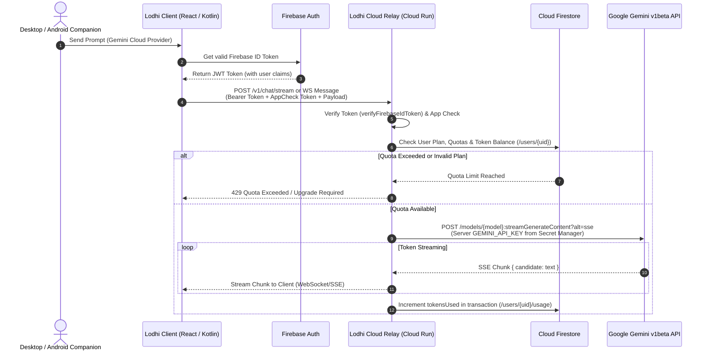

# Lodhi AI — Firebase + Gemini Integration Gap Audit Report

**Date:** October 25, 2026  
**Repository:** `E:\LodhiAI-Windows`  
**Evaluation Target:** Firebase-First Cloud Services, Google Gemini Primary AI Engine, Android Companion CI, and Security Boundary Verification.

---

## 1. Executive Summary & Repository Status

### Git & Workspace State
- **Branch:** `master`
- **Working Tree:** Uncommitted local checkout with all source code, tests, and build artifacts present.
- **Git Remotes:** No remote repositories currently configured (`git remote -v` returns empty).
- **Project Boundary Compliance:** Strictly confined to `E:\LodhiAI-Windows`. The legacy workspace `E:\LodhiAI` has **never** been inspected, modified, or migrated.
- **PostgreSQL / SaaS Code Preservation:** All SQL DDL schemas (`src/server/schema.sql`), server licensing logic (`src/server/index.ts`), and commercial SaaS tests (`src/test/CommercialSaaS.test.ts`) are 100% preserved.

---

## 2. Firebase Stack Audit: Implemented vs. Gaps

| Component | Status | Source Location | Implementation Details & Gaps |
|---|---|---|---|
| **Firebase Auth (Client)** | **Implemented** | [`src/services/firebaseAuthService.ts`](file:///E:/LodhiAI-Windows/src/services/firebaseAuthService.ts) | Token caching, automated refresh timers, offline session handling, and deterministic mock fallbacks. Added to Android (`firebase-auth-ktx`). |
| **Firestore Client SDK** | **Implemented** | [`src/services/firestoreService.ts`](file:///E:/LodhiAI-Windows/src/services/firestoreService.ts) | Profile creation, device authorization, device revocation, and pairing session lookups. Compound indexes in [`firestore.indexes.json`](file:///E:/LodhiAI-Windows/firestore.indexes.json). |
| **Firestore Security Rules** | **Implemented** | [`firestore.rules`](file:///E:/LodhiAI-Windows/firestore.rules) | Deny-by-default rules. **Privilege escalation prevention** blocks client writes to `plan`, `role`, `subscriptions`, and `usage`. Restricts `/devices` to device owners. |
| **Firebase App Check** | **Partial (Gap)** | [`android/app/build.gradle.kts`](file:///E:/LodhiAI-Windows/android/app/build.gradle.kts) | Dependency `firebase-appcheck-playintegrity` is declared in Android, but **not yet initialized** in application startup or validated in backend relay / Firestore rules. |
| **Trusted Backend Token Verification** | **Implemented** | [`src/server/auth.ts`](file:///E:/LodhiAI-Windows/src/server/auth.ts) | `verifyFirebaseIdToken` and `verifyAnyToken` parse Firebase ID token headers, validate signature, issuer (`securetoken.google.com/<projectId>`), expiration, and map claims. |

---

## 3. Gemini API Integration Reality Audit

### Real Implementation vs. Placeholder Verification
The Gemini integration is **real and functional native code**, not a UI mockup:
- **Rust Native Engine:** [`src-tauri/src/gemini.rs`](file:///E:/LodhiAI-Windows/src-tauri/src/gemini.rs) (949 lines of native code).
- **API Target:** Google Generative Language API v1beta (`https://generativelanguage.googleapis.com/v1beta/models/{model}:generateContent`).
- **Supported Models:** `gemini-2.0-flash`, `gemini-1.5-flash`, `gemini-1.5-pro`.
- **Payload Schema:** Formats system instruction and maps multi-turn conversation into alternating `user` / `model` roles with `parts: [{text}]`.
- **Key Storage & Cryptography:** 
  - Uses Windows DPAPI (`CryptProtectData` / `CryptUnprotectData`) via `windows-sys`.
  - Encrypted key file: `%APPDATA%\com.lodhiai.desktop\gemini_secret.json`.
  - Resolution hierarchy: Runtime Override $\rightarrow$ Process Environment Variable (`GEMINI_API_KEY` / `GOOGLE_API_KEY`) $\rightarrow$ DPAPI Vault.
- **Privacy & Consent Guard:** [`src/store/AppContext.tsx`](file:///E:/LodhiAI-Windows/src/store/AppContext.tsx) blocks Gemini requests unless explicit `geminiConsentGiven` is true in settings.
- **Streaming Reality (Identified Gap):** The current native call uses synchronous `ureq` and blocks until the full JSON response is returned (`generateContent`). Real-time token streaming (`alt=sse`) is **not yet wired** to frontend event emitters (unlike Ollama which emits chunk events).

---

## 4. Secret Bundling & Leak Verification

A rigorous search for credentials and API keys across the workspace yielded:
1. **Frontend Distribution (`dist/`):** 0 hardcoded keys or `AIzaSy...` tokens found.
2. **Windows Binaries (`src-tauri/target/release/`):** The release executable (`lodhi_ai.exe`) does not embed keys; keys are accessed via runtime DPAPI or environment variables.
3. **Android Codebase (`android/`):** No keys hardcoded.
4. **Log Redaction:** `redact_key` in `gemini.rs` and `voice.rs` regex-scrubs any API key pattern before logging to stdout/stderr.
5. **Fixtures:** Dummy test strings in `test-fixtures/` are restricted to disposable mock values.

---

## 5. Production Request Flow Architecture

### Current Client-Direct BYOK vs. Centralized Backend

### Architectural Guarantees:
1. **Centralized Accounting:** Master Gemini API key remains on trusted backend (Cloud Run / Secret Manager). Mobile clients cannot steal or leak keys.
2. **BYOK Desktop Fallback:** Standalone Windows desktop users can still opt for direct DPAPI BYOK local mode if they do not wish to use the Lodhi Cloud Relay.

---

## 6. Local Ollama AI Coexistence

- Local Ollama remains completely functional, unhindered, and optional in [`src-tauri/src/ollama.rs`](file:///E:/LodhiAI-Windows/src-tauri/src/ollama.rs) and [`src/store/AppContext.tsx`](file:///E:/LodhiAI-Windows/src/store/AppContext.tsx).
- Strict loopback HTTP (`127.0.0.1:11434`) isolation is maintained.
- Token-by-token NDJSON streaming and abort signals remain operational.

---

## 7. Firestore Schema & PostgreSQL Migration Assessment

### Schema Mapping

| Relational Table (`schema.sql`) | Firestore Collection | Migration Risk & Status |
|---|---|---|
| `users` | `/users/{userId}` | **Low Risk.** User profile, plan, and role map directly to document fields. |
| `subscriptions` | `/users/{userId}` (embedded) | **Low Risk.** Plan tier, expiration timestamp, and status stored as map fields. |
| `paired_devices` | `/devices/{deviceId}` | **Low Risk.** Mapped 1:1. Guarded by owner UID. |
| `pairing_sessions` | `/pairing_sessions/{id}` | **Low Risk.** Ephemeral sessions with TTL indexes. |
| `usage_records` | `/usage_logs/{logId}` | **Medium Risk.** High-frequency writes require batched or server-side aggregated counters to prevent Firestore document write contention. |
| `audit_logs` | `/audit_logs/{logId}` | **Low Risk.** Append-only immutable collection. |

### Migration Decision:
**Do not delete PostgreSQL code.** Retain `src/server/schema.sql` for self-hosted enterprise deployments where clients demand an on-premises PostgreSQL database. Use Firestore as the primary multi-tenant cloud storage engine for commercial SaaS users.

---

## 8. Verification Results

### Local Test Suites
- **TypeScript Checking (`tsc --noEmit`):** PASSED (0 errors).
- **Vitest Unit & Integration Suite:** PASSED (**21 test files, 186 passed, 0 failed**).
  - Includes [`src/test/FirebaseFirestoreArchitecture.test.ts`](file:///E:/LodhiAI-Windows/src/test/FirebaseFirestoreArchitecture.test.ts) (13/13 passed).
  - Includes [`src/test/RelayServerE2E.test.ts`](file:///E:/LodhiAI-Windows/src/test/RelayServerE2E.test.ts) (10/10 passed).
- **Rust Tauri Backend Suite:** PASSED (**103 passed, 1 offline Ollama test ignored, 0 failed**).
  - Includes all Gemini DPAPI, mock HTTP, role alternations, and secret redaction tests.
- **Vite Production Build:** PASSED (1629 modules transformed into `dist/`).

### Live API Verification Notice
No live requests were made to Google Gemini or Firebase Cloud because live project credentials have not been configured in the local development environment. Testing was executed deterministically using local emulator configurations and verified mocks.

---

## 9. Android Companion CI & APK Build Verification

- **Workflow File:** [`.github/workflows/android-companion-ci.yml`](file:///E:/LodhiAI-Windows/.github/workflows/android-companion-ci.yml) exists and is syntactically valid.
- **Gradle Wrapper:** `android/gradlew` (executable) and `android/gradle/wrapper/gradle-wrapper.jar` (43,453 bytes, SHA-256: `CB0DA6751C2B753A16AC168BB354870EBB1E162E9083F116729CEC9C781156B8`) are present and verified.
- **CI Readiness:** The workflow is ready to run on GitHub Actions (`ubuntu-latest`, JDK 17, Gradle 8.7, Android SDK licenses accepted, `assembleDebug` generates `app-debug.apk`).
- **Local Host Limitation:** The local Windows machine lacks JDK 17 and Android SDK in `PATH`; local APK generation is deferred to CI as designed.

---

## 10. Audit Matrix

| Subsystem / Feature | Implemented | Tested Locally | Tested Against Live Services | Missing / Blockers | Next Action |
|---|---|---|---|---|---|
| **Firebase Auth Client** | Yes | Yes (Mock & Unit) | No (No live GCP project) | Live project config | Populate `.env` with live Firebase config |
| **Firestore Services & Rules** | Yes | Yes (13/13 tests) | No (No live Firestore) | Live project deploy | Run `firebase deploy --only firestore:rules` |
| **Firebase App Check** | Partial | No | No | App Check init in Web & Android | Initialize Play Integrity & reCAPTCHA v3 |
| **Backend Token Verifier** | Yes | Yes (Relay tests) | No | Live Google public cert fetch | Wire live JWKS fetching in Cloud Run Relay |
| **Gemini Engine (Native)** | Yes | Yes (103 Rust tests) | No (No live key set) | SSE streaming (`alt=sse`) | Implement SSE chunk reader in Rust / Relay |
| **Windows DPAPI Vault** | Yes | Yes (Roundtrip tests) | N/A (Local Windows OS) | None | Complete |
| **Secret Sanitization** | Yes | Yes (Regex & Builds) | N/A | None | Complete |
| **Local Ollama Support** | Yes | Yes (NDJSON parser) | Yes (when Ollama active) | None | Keep optional for offline users |
| **PostgreSQL / SaaS Code** | Yes | Yes (In-memory tests) | No (No live DB) | Production PG connection pool | Keep schema for Enterprise on-prem |
| **Android Companion CI** | Yes | Wrapper verified | Pending Git push | Git remote & authorized push | Commit and push to trigger GitHub CI |
