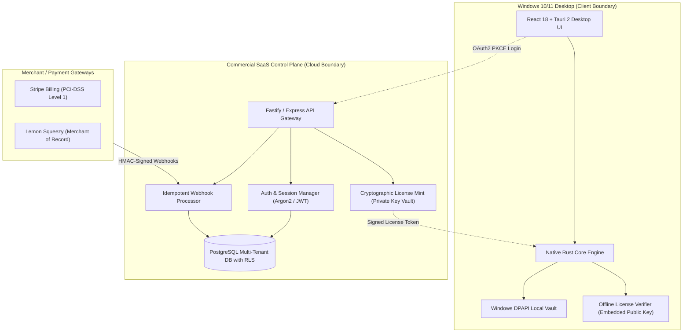

# Lodhi AI — Phase 11 Commercial SaaS Architecture & Global Specification

**Document Version:** 1.0.0  
**Date:** October 25, 2026  
**Architecture Lead:** Antigravity AI Engineering Team  
**Authorized Project Directory:** `E:\LodhiAI-Windows`  
**Legacy Project Boundary:** `E:\LodhiAI` (Strictly off-limits · 100% untouched)  
**Target Environments:** Windows 10/11 Desktop Client with Hybrid Enterprise Cloud Control Plane  

---

## 1. Executive Summary & Design Principles

Lodhi AI Windows is an **offline-first, privacy-respecting AI Developer Platform**. The commercial SaaS foundation is designed according to three fundamental architectural invariants:

1. **Client Zero-Trust:** Desktop client binaries can be inspected, disassembled, or tampered with by users. Consequently, the desktop client is never treated as a source of truth for subscription status, entitlements, or payment confirmations.
2. **Offline Community Sovereignty:** The Free Community Edition operates 100% locally and offline without requiring cloud accounts, sign-ins, network connectivity, or subscription tokens.
3. **Cryptographic Air-Gapped Licensing:** Subscriptions are minted server-side into digitally signed license tokens (Ed25519 / HMAC-SHA256) and verified offline by the desktop application using embedded public verification keys. Private keys never leave the secure signing infrastructure.



---

## 2. Customer Registration, Sessions & Authentication

### 2.1 Desktop Sign-in via OAuth 2.0 PKCE Loopback
To prevent credential exposure in desktop web views, desktop authentication uses the industry-standard PKCE (RFC 7636) loopback redirect flow:
1. **Challenge Generation:** Rust core generates a cryptographically secure random 64-character `code_verifier` and derives `code_challenge = BASE64URL(SHA256(code_verifier))`.
2. **Ephemeral Loopback Listener:** A temporary local HTTP server binds to a random loopback port (e.g. `127.0.0.1:49152/callback`).
3. **Browser Navigation:** The desktop opens the system default browser to:
   ```
   https://auth.lodhiai.com/oauth/authorize?response_type=code&client_id=lodhi-windows-desktop&redirect_uri=http://127.0.0.1:49152/callback&code_challenge=<challenge>&code_challenge_method=S256&scope=openid profile email
   ```
4. **Authorization Exchange:** Upon authentication, the browser redirects to the loopback server with an authorization code. Rust core posts the code and `code_verifier` to `/oauth/token` via TLS 1.3.
5. **Token Lifecycle:**
   - **Access Token:** Short-lived JWT (15-minute expiration) stored strictly in-memory.
   - **Refresh Token:** High-entropy cryptographically random string (30-day expiration) stored locally in Windows DPAPI (`CryptProtectData`).
   - **Rotation:** Every refresh token exchange invalidates the previous refresh token, mitigating replay risks.

### 2.2 Account Security & Anti-Abuse
- **Password Protection:** PBKDF2 with SHA-512 (600,000 iterations) or Argon2id with unique 16-byte cryptographic salts.
- **Rate Limiting:** IP and user-based sliding-window rate limiting (5 attempts per 15 minutes on login endpoints) with automated lockout.
- **Account Recovery:** Cryptographically random single-use tokens expiring in 15 minutes, dispatched to verified email addresses.

---

## 3. Subscription Tiers & Feature Matrix

| Feature / Quota | Free Community | Developer Pro | Business Team |
| :--- | :---: | :---: | :---: |
| **Pricing** | **Free Forever** | **$19 / month** | **$49 / seat / month** |
| **Local Ollama Inference** | Unlimited | Unlimited | Unlimited |
| **Workspace Security Sandbox** | Full (Canonicalized) | Full (Canonicalized) | Full (Canonicalized) |
| **AI Coding Agent & Backups** | Full (.bak + Rollback) | Full (.bak + Rollback) | Full (.bak + Rollback) |
| **Local Document RAG** | In-Memory (BM25) | In-Memory (BM25) | In-Memory (BM25) |
| **Offline Voice Engine** | Native Windows SAPI | Native Windows SAPI | Native Windows SAPI |
| **Cloud Inference (Gemini)** | BYOK (User Key) | 500k Tokens Included | 2.5M Tokens/seat Pooled |
| **Device Activations** | 1 PC | Up to 3 Personal PCs | Managed Fleet per Seat |
| **Support Channel** | Community Forum | 24-Hour Email SLA | Dedicated Priority SLA |
| **Deployment Model** | 100% Offline | Offline + Cloud Optional | Offline + Cloud Optional |

---

## 4. Multi-Tenant Isolation & PostgreSQL Row-Level Security (RLS)

All cloud data is isolated by `tenant_id` at the database level. PostgreSQL Row-Level Security ensures that queries cannot accidentally or maliciously access other tenants' records.

```sql
-- Multi-Tenant Database Schema with Row-Level Security
CREATE EXTENSION IF NOT EXISTS "uuid-ossp";

CREATE TABLE tenants (
    id UUID PRIMARY KEY DEFAULT uuid_generate_v4(),
    name VARCHAR(255) NOT NULL,
    plan VARCHAR(50) NOT NULL DEFAULT 'free',
    status VARCHAR(50) NOT NULL DEFAULT 'active',
    created_at TIMESTAMP WITH TIME ZONE DEFAULT CURRENT_TIMESTAMP,
    updated_at TIMESTAMP WITH TIME ZONE DEFAULT CURRENT_TIMESTAMP
);

CREATE TABLE users (
    id UUID PRIMARY KEY DEFAULT uuid_generate_v4(),
    tenant_id UUID NOT NULL REFERENCES tenants(id) ON DELETE CASCADE,
    email VARCHAR(255) UNIQUE NOT NULL,
    password_hash VARCHAR(255) NOT NULL,
    password_salt VARCHAR(64) NOT NULL,
    role VARCHAR(50) NOT NULL DEFAULT 'developer',
    created_at TIMESTAMP WITH TIME ZONE DEFAULT CURRENT_TIMESTAMP
);

CREATE TABLE subscriptions (
    id UUID PRIMARY KEY DEFAULT uuid_generate_v4(),
    tenant_id UUID NOT NULL REFERENCES tenants(id) ON DELETE CASCADE,
    gateway VARCHAR(50) NOT NULL, -- 'stripe' or 'lemonsqueezy'
    customer_id VARCHAR(255) NOT NULL,
    subscription_id VARCHAR(255) UNIQUE NOT NULL,
    tier VARCHAR(50) NOT NULL,
    status VARCHAR(50) NOT NULL,
    current_period_end TIMESTAMP WITH TIME ZONE NOT NULL,
    created_at TIMESTAMP WITH TIME ZONE DEFAULT CURRENT_TIMESTAMP
);

CREATE TABLE idempotency_keys (
    key VARCHAR(255) PRIMARY KEY,
    event_type VARCHAR(100) NOT NULL,
    processed_at TIMESTAMP WITH TIME ZONE DEFAULT CURRENT_TIMESTAMP
);

CREATE TABLE audit_logs (
    id UUID PRIMARY KEY DEFAULT uuid_generate_v4(),
    tenant_id UUID NOT NULL REFERENCES tenants(id) ON DELETE CASCADE,
    user_id UUID,
    action VARCHAR(100) NOT NULL,
    resource VARCHAR(100) NOT NULL,
    ip_address VARCHAR(45),
    created_at TIMESTAMP WITH TIME ZONE DEFAULT CURRENT_TIMESTAMP
);

-- Row-Level Security Enforcement
ALTER TABLE subscriptions ENABLE ROW LEVEL SECURITY;
ALTER TABLE audit_logs ENABLE ROW LEVEL SECURITY;

CREATE POLICY tenant_isolation_subscriptions ON subscriptions
    FOR ALL
    USING (tenant_id = current_setting('app.current_tenant_id', true)::uuid);

CREATE POLICY tenant_isolation_audit ON audit_logs
    FOR ALL
    USING (tenant_id = current_setting('app.current_tenant_id', true)::uuid);
```

---

## 5. Payment Provider Strategy & Pakistan Market Analysis

### 5.1 Payment Provider Landscape for Pakistan Founders

| Criteria | Stripe Direct | Stripe Atlas (US Entity) | Lemon Squeezy (MoR) |
| :--- | :--- | :--- | :--- |
| **Availability in Pakistan** | **Unavailable** (Pakistan not supported for direct merchant accounts) | **Available** (incorporates Delaware C-Corp / LLC + US Bank Account) | **Available** (Direct payouts to Pakistan Payoneer / Wise accounts) |
| **Merchant of Record (MoR)** | No (Platform assumes all tax liabilities) | No (US entity handles sales tax & corporate filings) | **Yes** (Lemon Squeezy calculates, collects, and remits VAT/sales tax globally) |
| **Setup Cost** | $0 | ~$500 incorporation + $100–300/yr franchise tax | **$0 upfront** |
| **Transaction Fees** | 2.9% + $0.30 | 2.9% + $0.30 + corporate maintenance | 5% + $0.50 |
| **Pakistani Card Acceptance** | Global cards | Global cards | Global cards + Pakistani debit/credit cards enabled for e-commerce |
| **FBR & Withholding Tax** | N/A | Requires US IRS filings (Form 1120/5472) | Compliant software export remittances via SBP PRAL codes |

### 5.2 Recommended Payment Strategy
1. **Initial Global Commercial Launch:** Use **Lemon Squeezy** as the Merchant of Record. This avoids incorporating a foreign entity, resolves global VAT/sales tax liabilities automatically, and enables direct payout to Pakistan via Payoneer/Wise.
2. **Scale & Enterprise Phase:** Transition to **Stripe Billing** via a US Delaware LLC (Stripe Atlas) once monthly recurring revenue exceeds $10,000/month.

### 5.3 Asynchronous Webhook Architecture
- All payments and subscription state changes are processed via cryptographically signed webhooks.
- **Stripe:** Verifies `Stripe-Signature` using `v1` HMAC-SHA256 with timestamp tolerance (prevents replay attacks).
- **Lemon Squeezy:** Verifies `X-Signature` using HMAC-SHA256 against raw webhook request body.
- **Idempotency Guarantee:** Every incoming webhook event ID (`evt_...`) is recorded in the `idempotency_keys` table. Duplicate webhook deliveries are acknowledged with HTTP 200 without duplicate database mutations.

---

## 6. Cryptographic Offline Licensing Engine

Subscriptions generate digitally signed license tickets compatible with the desktop Rust verifier:

### 6.1 Token Structure
A 3-part base64url-encoded string: `HEADER.PAYLOAD.SIGNATURE`
- **Header:**
  ```json
  { "alg": "LODHI-SHA256-V1", "typ": "LODHI_LIC" }
  ```
- **Payload:**
  ```json
  {
    "licenseId": "lic_9a8b7c6d5e4f",
    "issuer": "lodhiai.com",
    "subject": "umar@lodhiai.com",
    "tier": "pro",
    "features": ["ai_chat", "coding_agent", "voice_conversation", "rag_knowledge_base"],
    "issuedAt": 1792912000,
    "expiresAt": 1824448000,
    "deviceId": "composite_hash_machine_1"
  }
  ```
- **Signature:** Base64URL-encoded HMAC-SHA256 digest of `header.payload` signed with the private key.

### 6.2 Key Management
- **Private Key:** Stored exclusively in cloud server environment secrets (`LODHI_LICENSE_SIGNING_KEY`). Never committed to source control or distributed in binaries.
- **Public Key:** Embedded in `src-tauri/src/licensing.rs` (`LODHI_PUBLIC_VERIFY_KEY`).
- **Offline Lease:** The desktop app checks validity offline; if expired, it reverts gracefully to Free Community mode without blocking local Ollama inference.
