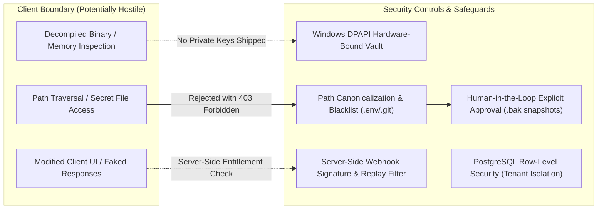

# Lodhi AI — Phase 11 Security Review & Threat Model

**Document Version:** 1.0.0  
**Date:** October 25, 2026  
**Security Lead:** Antigravity AI Engineering Team  
**Authorized Project Directory:** `E:\LodhiAI-Windows`  
**Legacy Project Boundary:** `E:\LodhiAI` (Strictly off-limits · 100% isolated)  

---

## 1. Security Architecture & Threat Model

Lodhi AI Windows applies a **Defense-in-Depth** and **Zero-Trust Client** security model across the client-cloud boundary.

---

## 2. Threat Analysis & Security Controls

### 2.1 Threat: Client-Side Binary Tampering & License Bypass
- **Threat:** An adversary decompiles `lodhi-ai.exe` or intercepts Tauri IPC to simulate a "Pro" license status.
- **Mitigation:**
  - The client binary contains **only the public verification key** (`LODHI_PUBLIC_VERIFY_KEY`).
  - Private signing keys reside strictly on air-gapped cloud infrastructure.
  - Server-side cloud inference proxies and multi-device sync evaluate digitally signed license tokens server-side before serving requests.
  - Local Free Community Edition functions fully offline without needing cloud validation.

### 2.2 Threat: Payment Webhook Forgery & Replay Attacks
- **Threat:** An attacker crafts simulated `checkout.session.completed` HTTP calls to grant themselves paid entitlements.
- **Mitigation:**
  - Every incoming Stripe webhook is verified using `Stripe-Signature` HMAC-SHA256 with timestamp tolerance (`toleranceSeconds = 300`).
  - Requests with timestamps older than 5 minutes or in the future are rejected.
  - Lemon Squeezy webhooks verify `X-Signature` using constant-time buffer comparison (`crypto.timingSafeEqual`).
  - Webhook processing is idempotent: duplicate delivery of event IDs does not re-credit or double-upgrade accounts.

### 2.3 Threat: Multi-Tenant Cross-Contamination
- **Threat:** A tenant developer crafts a SQL injection or manipulated API parameter to access another organization's conversations or audit logs.
- **Mitigation:**
  - Multi-tenant data segregation is enforced at the database kernel via PostgreSQL Row-Level Security (RLS).
  - Every incoming query binds `app.current_tenant_id` to the session.
  - Even if application code omits `WHERE tenant_id = ...`, the database engine strictly filters out records belonging to other tenants.

### 2.4 Threat: Credential Theft & Vault Exposure
- **Threat:** Malicious processes running on the user's desktop attempt to steal stored Google Gemini API keys or OAuth refresh tokens.
- **Mitigation:**
  - Sensitive secrets are never stored in plaintext JSON or `.env` files.
  - On Windows, secrets are encrypted using the Windows Data Protection API (`CryptProtectData`), cryptographically keyed to the user's Windows logon credentials.
  - Only the user's interactive Windows session can decrypt the vault.

### 2.5 Threat: Workspace Sandboxing & Path Traversal
- **Threat:** An AI prompt or rogue command attempts to read `C:\Windows\System32`, `id_rsa`, or `.env` files.
- **Mitigation:**
  - Strict path canonicalization (`std::fs::canonicalize`) validates that target paths reside inside the user-selected workspace root.
  - Symlink escapes and traversal patterns (`../`) are blocked natively in Rust.
  - Critical sensitive filenames (`.env`, `.git/`, `.ssh/`, `.pem`) are hard-blocked from file reading and listing.

---

## 3. Cryptographic Specification

| Component | Primitive / Algorithm | Key Length / Parameters | Storage Location |
| :--- | :--- | :--- | :--- |
| **Password Hasher** | PBKDF2 with SHA-512 | 100,000 iterations, 16-byte salt | PostgreSQL `password_hash` & `password_salt` |
| **Session Tokens** | JWT (HS256) | 256-bit secret, 15-minute expiry | In-Memory (Client) / Server Secret |
| **License Tokens** | HMAC-SHA256 (LODHI-SHA256-V1) | 256-bit private key | Server Vault / Embedded Public Key |
| **Stripe Webhook** | HMAC-SHA256 (v1) | Stripe endpoint secret | Server Environment (`STRIPE_WEBHOOK_SECRET`) |
| **Lemon Squeezy** | HMAC-SHA256 | Webhook secret | Server Environment (`LEMON_SQUEEZY_SECRET`) |
| **Local Desktop Vault** | Windows DPAPI (Triple-DES / AES-256) | Machine + User SID Keyed | `%APPDATA%\com.lodhiai.desktop\` |

---

## 4. Residual Risks & Production Recommendations

1. **Production Code Signing:** The desktop executable `lodhi-ai.exe` currently uses an unsigned binary for local builds. Production public distribution requires an EV Code Signing Certificate to eliminate Windows SmartScreen warnings.
2. **Key Rotation Protocol:** Implement automated 90-day rotation for JWT signing secrets and database connection credentials.
3. **Web Ingress TLS 1.3:** Enforce HSTS (HTTP Strict Transport Security) with preloading on all public cloud SaaS endpoints.
