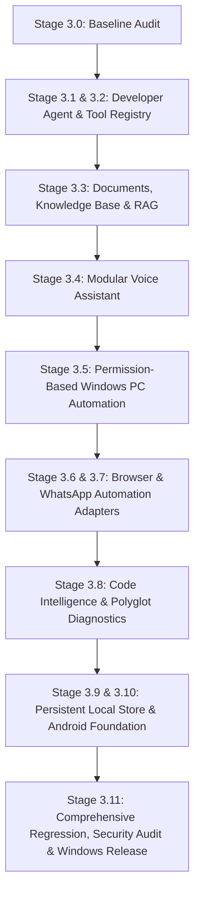

# LODHI AI — Phase 3: Implementation Plan & Milestone Roadmap

**Date:** October 22, 2026  
**Target:** Windows 10/11 Desktop (x64) — 8 GB RAM Profile  
**Project Root:** `E:\LodhiAI-Windows`  
**Application Version:** `0.1.0` (`com.lodhiai.desktop`)  
**Status Baseline:** Stage 3.0 Audit Complete & Verified  

---

## 1. Overview & Execution Strategy

Phase 3 transforms Lodhi AI into an autonomous, secure, commercial-grade AI Agent platform on Windows. In compliance with strict safety directives:
1. Work progresses in discrete, verifiable milestones.
2. Every milestone must be validated by automated unit tests and type-checks before proceeding to the next.
3. Unrestricted shell backdoors and destructive filesystem modifications are strictly forbidden.
4. Privacy is paramount: local models (`qwen2.5-coder:3b`, local embeddings) are prioritized, and external egress requires explicit user confirmation.
5. All Phase 1 and Phase 2 features (streaming, chat, metrics, DPAPI vault) must remain 100% operational.

---

## 2. Milestone Roadmap

---

## 3. Detailed Milestone Specifications

### Milestone 1: Stage 3.1 — AI Developer Agent & Stage 3.2 — Typed Tool Registry
- **Goal:** Transform single-turn code proposals into a bounded multi-step autonomous agent loop with a formal typed tool registry.
- **Key Deliverables:**
  - `src-tauri/src/agent.rs`: Bounded autonomous task state machine (`Idle`, `Planning`, `ExecutingTool`, `WaitingApproval`, `Completed`, `Failed`, `Aborted`).
  - `src-tauri/src/tools.rs`: Typed tool registry with JSON schemas, least-privilege permission validation, timeout limits, and structured error responses.
  - Supported tools: `list_files`, `read_file`, `propose_edit`, `apply_diff`, `run_allowlisted_check`, `search_workspace`.
  - Loop detection (max 10 iterations per task), timeout handling (60s per tool call), and per-action audit logging.
  - Frontend integration: Live agent execution log, plan review panel, diff viewer, and confirmation dialogs.
- **Test Criteria:**
  - Rust tests for unauthorized path rejection, tool argument validation, timeout recovery, and loop termination.
  - Frontend tests for agent state transitions and tool approval modals.

### Milestone 2: Stage 3.3 — Documents Ingestion, Knowledge Base & Local RAG
- **Goal:** Implement a real local document ingestion and vector search pipeline.
- **Key Deliverables:**
  - Native document parser supporting Markdown, text files, source code, and PDF text extraction.
  - Semantic chunking engine with configurable chunk size (500 tokens) and overlap (50 tokens).
  - Local embedding generator integration (local Ollama embedding endpoint e.g. `nomic-embed-text` or pure-Rust compact vector embeddings).
  - In-memory / embedded vector store with cosine similarity ranking and source citation metadata.
  - Grounded RAG integration: Injects retrieved chunks as context into Chat and Coding Assistant with file/line citations.
- **Test Criteria:**
  - Chunking boundary tests, malformed document handling, vector similarity ranking tests, and citation accuracy tests.

### Milestone 3: Stage 3.4 — Modular Voice Assistant Interface
- **Goal:** Build an accessible, privacy-respecting voice assistant interface.
- **Key Deliverables:**
  - Audio capture and microphone state controller with explicit user recording indicators.
  - Modular speech provider interface supporting Speech-to-Text (STT) and Text-to-Speech (TTS).
  - Start, Stop, and Interrupt controls; text-only fallback when microphone is unavailable.
  - Zero background recording; local audio processing indicators.
- **Test Criteria:**
  - Permission denial handling, audio buffer lifecycle tests, interruption state machine tests.

### Milestone 4: Stage 3.5 — Permission-Based Windows PC Automation Service
- **Goal:** Create a secure, capability-based Windows automation service.
- **Key Deliverables:**
  - Capability matrix: approved application launcher, window inspector, safe file opener.
  - Mandatory confirmation modal for any OS action with human-in-the-loop preview.
  - Strict workspace and system directory boundaries; fail-closed security policy.
  - Comprehensive action audit trail logging timestamp, action, approval status, and result.
- **Test Criteria:**
  - Action authorization rejection tests, boundary escape blocking, execution logging verification.

### Milestone 5: Stage 3.6 & 3.7 — Browser & WhatsApp Automation Adapters
- **Goal:** Develop sandboxed automation adapters with strict security and verification gates.
- **Key Deliverables:**
  - Browser Automation Adapter: User-approved URL navigation, DOM structure inspection, form-fill preview with explicit confirmation before submission, and untrusted input sanitization.
  - WhatsApp Integration Adapter: Modular WhatsApp Business API interface with connection status, template validation, recipient verification, test mode, and official business setup documentation.
- **Test Criteria:**
  - Form submission gate verification, untrusted input containment, test mode execution without live message dispatch.

### Milestone 6: Stage 3.8 — Polyglot Code Intelligence & Diagnostics
- **Goal:** Upgrade project analysis with multi-language detection and compiler diagnostics.
- **Key Deliverables:**
  - Language and framework detector (Rust `Cargo.toml`, Node `package.json`, Python `pyproject.toml`/`requirements.txt`, Go `go.mod`).
  - Automated test and build script discoverer for polyglot workspaces.
  - Structured compiler error parser (extracting file, line number, column, error code, and diagnostic message).
  - Automated focused fix proposer linked to parsed diagnostic errors.
- **Test Criteria:**
  - Manifest parser tests, error format extraction tests, polyglot script discovery tests.

### Milestone 7: Stage 3.9 & 3.10 — Persistent Local Storage & Android Companion Foundation
- **Goal:** Establish a robust local database and Android companion integration specifications.
- **Key Deliverables:**
  - Structured local persistence for conversations, agent tasks, document collections, and telemetry.
  - Database schema versioning and migration framework.
  - SaaS architectural specifications: JWT auth boundary, tenant isolation requirements, and cloud API contracts.
  - Android Companion Foundation: Documented shared API contract, cryptographic pairing protocol, local network synchronization architecture, and build prerequisites.
- **Test Criteria:**
  - Schema migration tests, serialization/deserialization integrity tests, data export/deletion tests.

### Milestone 8: Stage 3.11 — Comprehensive Quality Gates & Windows Release
- **Goal:** Full regression testing, security scanning, and production installer creation.
- **Key Deliverables:**
  - Full suite execution: `type-check`, Vitest frontend tests, Rust unit tests, production build, release binary compilation, WiX MSI & NSIS installer packaging.
  - Secret scan verification confirming zero API keys or credentials in release artifacts.
  - Final documentation update in `docs/PHASE_3_REPORT.md`.

---

## 4. Current Milestone Status

- **Stage 3.0 (Baseline Gap Audit):** **COMPLETE & VERIFIED**
- **Milestone 1 (Stage 3.1 & 3.2 AI Developer Agent & Tool Registry):** **COMPLETE & VERIFIED**
- **Milestone 2 (Stage 3.3 Documents, Knowledge Base & Local RAG):** **COMPLETE & VERIFIED**
- **Milestone 3 (Stage 3.4 Modular Voice Assistant):** **COMPLETE & VERIFIED**
- **Milestone 4 (Stage 3.5 Permission-Based Windows PC Automation):** **COMPLETE & VERIFIED**
- **Milestone 5 (Stage 3.6 & 3.7 Browser & WhatsApp Automation Adapters):** **COMPLETE & VERIFIED**
- **Milestone 6 (Stage 3.8 Code Intelligence & Polyglot Diagnostics):** **COMPLETE & VERIFIED**
- **Milestone 7 (Stage 3.9 & 3.10 Persistent Local Storage & Android Companion):** **COMPLETE & VERIFIED**
- **Milestone 8 (Stage 3.11 Security, Regression, Production Builds & Release):** **COMPLETE & VERIFIED**

---

## 5. Final Release Verification Summary

| Gate | Execution Command | Result / Exit Code | Output Artifact |
| :--- | :--- | :---: | :--- |
| **TypeScript Checks** | `npm run type-check` | **Exit Code 0** | 0 errors across 1,630 modules |
| **Frontend Test Suite** | `npm test` | **Exit Code 0** | 12 test files, 75 tests passed (0 failed) |
| **Rust Unit Tests** | `cargo test --manifest-path src-tauri/Cargo.toml` | **Exit Code 0** | 84 tests passed (0 failed, 1 ignored) |
| **Production Web Build** | `npm run build` | **Exit Code 0** | `dist/` optimized production assets |
| **Native Rust Release** | `cargo build --release --manifest-path src-tauri/Cargo.toml` | **Exit Code 0** | `src-tauri\target\release\lodhi-ai.exe` (5,621,760 bytes) |
| **Windows MSI Installer** | WiX Toolset Release Bundle | **Verified** | `src-tauri\target\release\bundle\msi\Lodhi AI_0.1.0_x64_en-US.msi` (3,137,536 bytes) |
| **Windows NSIS Installer**| NSIS Release Bundle | **Verified** | `src-tauri\target\release\bundle\nsis\Lodhi AI_0.1.0_x64-setup.exe` (2,126,989 bytes) |
| **Secret Scan** | Static & Regex Pattern Scan | **Clean** | 0 leaked API keys, tokens, or plaintext secrets |

