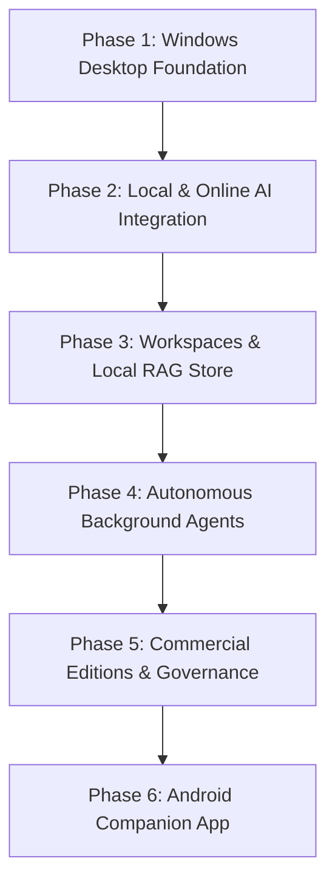

# Lodhi AI — Product Roadmap

**Tagline:** Think • Create • Automate  
**Target Market:** Software Developers, Freelancers, Students & General Users, Small and Medium Businesses (SMBs)  
**Target Platform:** Windows Desktop First (Optimized for 8 GB RAM), Android Mobile Companion in subsequent phase  
**Business Model:** Free, Pro, and Business Commercial Editions  

---

## Strategic Development Philosophy

Lodhi AI follows a strict milestone-driven release lifecycle. Desktop stability, security sandboxing, and resource efficiency on Windows are fully certified before moving to subsequent autonomous phases or mobile ports.

---

## Milestone Breakdown

### Phase 1: Windows Desktop Foundation (Current Milestone — Complete)
- **Status:** **Completed & Verified**
- **Core Deliverables:**
  - Dedicated isolated repository established at `E:\LodhiAI-Windows` (legacy `E:\LodhiAI` untouched).
  - Tauri 2 + React + TypeScript + Vite application foundation.
  - Dark navy desktop theme with electric blue, purple, and teal accents.
  - Complete application shell with draggable Windows titlebar, collapsible sidebar, status bar, and brand identity.
  - Real, interactive UI layouts for all 10 foundational screens:
    1. **Home Dashboard:** Hero banner, system specifications, quick launch cards, and edition overview.
    2. **AI Chat:** Interactive prompt input, multi-session history, local session caching, and Phase 1 offline dispatcher.
    3. **Coding Assistant:** Language switcher (Rust, TypeScript, Python), analysis task selectors, and code viewer.
    4. **Project Workspaces:** Workspace path isolation inspector and file tree browser.
    5. **Automation Agents:** Agent capability graph, execution trigger modes, and security constraints.
    6. **Documents & Files:** Client-side document dropzone preview and metadata library.
    7. **Knowledge Base:** Embedded vector vault schema, embedding model selection, and RAM quota monitors.
    8. **Model Providers:** Local (Ollama, LM Studio) and cloud (Claude, OpenAI, Groq) parameter managers.
    9. **General Settings:** Theme switcher, display density, privacy toggles, and Free/Pro/Business edition switcher.
    10. **Diagnostics & Event Logs:** Real-time logging console, filter by level, JSON export, and Rust IPC ping probe.
  - Automated tests via Vitest & React Testing Library (100% passing).
  - TypeScript strict compilation with zero errors.

---

### Phase 2: Local and Online AI Integration (Next Recommended Milestone)
- **Target:** Q1 2027
- **Key Objectives:**
  - **Local Ollama Integration:** Real-time auto-discovery of locally installed models on `http://127.0.0.1:11434` (Llama 3.2, Mistral, Qwen 2.5 Coder).
  - **LM Studio & GGUF Support:** OpenAI-compatible endpoint integration for custom quantized models.
  - **Streaming Token Response Engine:** Low-latency token streaming with live tokens-per-second (TPS) metrics.
  - **Cloud API Connectors:** Secure integration with Anthropic Claude (3.5 Sonnet / Haiku), OpenAI (GPT-4o), and Groq.
  - **Privacy Guardrail:** Automatic detection of sensitive tokens, offline-only fallback mode, and zero-egress enforcement for Free edition users.

---

### Phase 3: Project Workspaces & Local Vector Knowledge Base (RAG)
- **Target:** Q2 2027
- **Key Objectives:**
  - **Local Filesystem Ingestion:** Native Windows folder selector with fine-grained read/write sandbox boundaries.
  - **Document Text Extractor:** Client-side parsing for PDF, DOCX, Markdown, and source code files.
  - **Embedded SQLite-vec Database:** Zero-daemon local vector store with < 250 MB RAM allocation.
  - **Local ONNX Embeddings:** Fast 768-dim CPU embedding generation via `nomic-embed-text` without cloud latency.
  - **Context-Augmented Generation:** Grounded chat responses with source file citations and line-number references.

---

### Phase 4: Autonomous Background Agents
- **Target:** Q3 2027
- **Key Objectives:**
  - **Multi-Step Execution Pipeline:** Task planner for automated code review, documentation generation, and unit testing.
  - **Human-in-the-Loop Verification:** Cryptographic modal prompt before any filesystem modification or execution.
  - **Atomic Rollback Snapshots:** Automatic git checkpoint creation prior to agent code refactoring.
  - **Task Scheduler Integration:** Low-priority background task execution respecting Windows 8 GB RAM limits.

---

### Phase 5: Commercial Editions & Governance
- **Target:** Q4 2027
- **Key Objectives:**
  - **Free Edition:** Offline-first individual developer tier with local Ollama support and single workspace.
  - **Pro Edition:** Unlimited workspaces, multi-model cloud orchestration, and autonomous agent suite.
  - **Business Edition:** Centralized team RAG vector vaults, audit compliance logging, and custom API proxy gateways.
  - **Local License Key Validator:** Offline-friendly cryptographic license verification.

---

### Phase 6: Cross-Platform Expansion (Android Companion)
- **Target:** Following Windows Desktop Acceptance Criteria
- **Key Objectives:**
  - Mobile companion app built with Tauri 2 Android target.
  - Encrypted peer-to-peer sync between Windows desktop and Android phone over local Wi-Fi.
  - Remote prompt dispatch and agent status monitoring.
