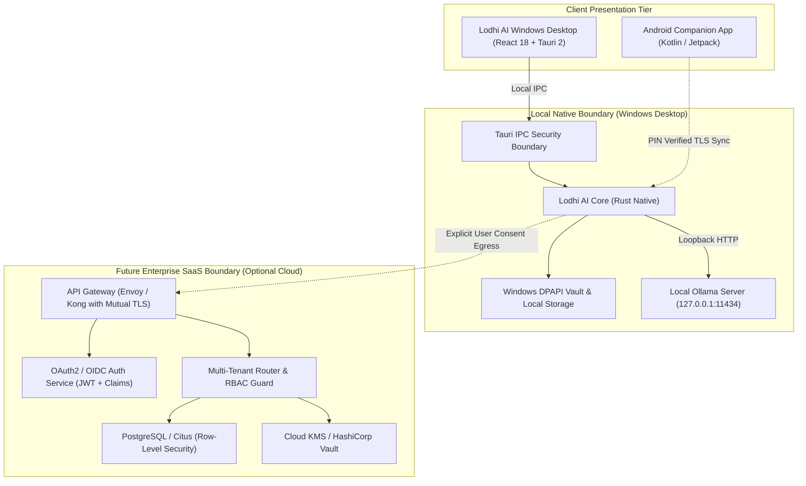

# Lodhi AI — SaaS Architecture, Multi-Tenant Boundaries & Security Specification

**Version:** 1.0.0 (Phase 3 Production Foundation)  
**Security Profile:** Least-Privilege Isolated Sandbox / Cloud-Egress Consent Mandate  
**Target Environments:** Windows Desktop Foundation (Local Native) & Future Enterprise Cloud SaaS  

---

## 1. Architectural Philosophy & Deployment Boundaries

Lodhi AI follows a **Local-First, Cloud-Optional** architecture designed to guarantee absolute data privacy on local desktop environments while establishing rigorous architectural boundaries for future enterprise multi-tenant cloud deployments.



---

## 2. Multi-Tenant Isolation Model

For enterprise cloud SaaS deployments, tenant isolation is enforced at multiple architectural layers:

### 2.1 Logical Isolation via Row-Level Security (RLS)
Every persistent table in the central database schema must enforce PostgreSQL Row-Level Security:
```sql
ALTER TABLE conversations ENABLE ROW LEVEL SECURITY;

CREATE POLICY tenant_isolation_policy ON conversations
    FOR ALL
    USING (tenant_id = current_setting('app.current_tenant_id', true)::uuid);
```

### 2.2 Tenant Context Propagation
- Every incoming HTTP/gRPC request to the SaaS gateway must carry a signed JWT token containing:
  - `sub`: User UUID
  - `tenant_id`: Organization UUID
  - `roles`: `["tenant:admin"]` | `["tenant:developer"]` | `["tenant:viewer"]`
  - `exp`: Expiration timestamp (max 1 hour)
- The API Gateway validates token signatures against the asymmetric JWKS endpoint before forwarding requests to microservices.

### 2.3 Strict Database Separation Options
For regulated enterprise clients (Healthcare, Finance, Defense), Lodhi AI supports:
1. **Shared Database, Shared Schema (Default SaaS):** Tenant separation enforced via RLS and cryptographically bound tenant context.
2. **Shared Database, Separate Schema:** Individual PostgreSQL schemas (`tenant_<uuid>`) per enterprise.
3. **Dedicated Database (VPC / On-Premise):** Fully air-gapped database instance managed under client VPC.

---

## 3. Role-Based Access Control (RBAC) Matrix

| Operation | Anonymous | Tenant Viewer | Tenant Developer | Tenant Admin |
| :--- | :---: | :---: | :---: | :---: |
| **Inspect System & App Version** | Yes | Yes | Yes | Yes |
| **Read Knowledge Base Documents** | No | Yes | Yes | Yes |
| **Ingest / Reindex Documents** | No | No | Yes | Yes |
| **Send Chat Message (Local Ollama)**| No | Yes | Yes | Yes |
| **Send Chat Message (Cloud Egress)** | No | No | Yes (if enabled) | Yes |
| **Execute Read-Only Workspace Tools** | No | No | Yes | Yes |
| **Apply Code Edit / Diff to Disk** | No | No | Yes (Approval) | Yes |
| **Run Allowlisted Build / Check Scripts** | No | No | Yes (Approval) | Yes |
| **Execute Windows / Browser Automation** | No | No | Yes (Approval) | Yes |
| **Configure API Keys & Vault Secrets** | No | No | No | Yes |
| **Manage Paired Android Companions** | No | No | Yes | Yes |
| **Export / Purge All Tenant Data** | No | No | No | Yes |

---

## 4. Secrets Management & Key Lifecycle

### 4.1 Local Desktop (Current Implementation)
- Windows Data Protection API (`DPAPI` via `CryptProtectData` / `CryptUnprotectData` in `gemini.rs` and `whatsapp.rs`).
- Secrets are encrypted using hardware-backed user credential keys and saved to `%APPDATA%\com.lodhiai.desktop\`.
- Plaintext API keys and access tokens are **never** logged, never exposed to frontend JavaScript, and never written to `localStorage`.

### 4.2 Enterprise Cloud SaaS (Specification)
- Master encryption keys managed via **AWS KMS**, **GCP Cloud KMS**, or **HashiCorp Vault**.
- Zero plaintext database storage: API keys and credentials encrypted using envelope encryption with per-tenant DEKs (Data Encryption Keys).
- Automated key rotation every 90 days.

---

## 5. Data Retention, Portability & GDPR Compliance

1. **User Data Portability (Export):**
   - Implemented natively via `export_user_data()` command.
   - Generates an uncorrupted, standard JSON archive containing all stored settings, conversation histories, tasks, and audit summaries.

2. **Right to Be Forgotten (Purge / Deletion):**
   - Implemented natively via `purge_user_data(retention_days)`.
   - Passing `retention_days: 0` triggers a complete, cryptographic wipe of all stored conversations, messages, and task checkpoints.

3. **Data Retention Policies:**
   - Configurable in user settings: `0` (indefinite), `30` days, `60` days, or `90` days.
   - Stored sessions older than the retention threshold are purged automatically during maintenance passes.

---

## 6. Cloud-Egress Consent Policy

Lodhi AI enforces a mandatory **Privacy Guard**:
- **Default State:** Offline and isolated. All chat queries execute locally via Ollama (`127.0.0.1:11434`).
- **Cloud Activation:** Cloud AI egress (e.g. Gemini) requires explicit user activation and consent toggle in Model Settings.
- **Pre-flight Egress Gate:** Even with configured keys, if `allow_cloud_egress == false`, outgoing cloud requests are blocked before network transmission.
