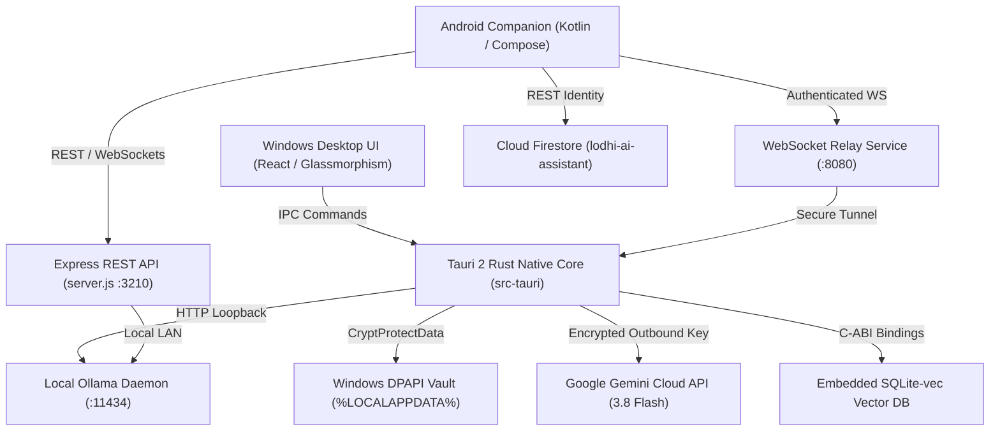

# LODHI AI — FEATURE DEPENDENCY AND ARCHITECTURAL MAP
**Audit Date:** October 29, 2026  
**Auditor:** DeepMind Antigravity AI Engineering Team  
**Objective:** Map dependencies across PC backend, Android companion, AI inference engines, cryptographic vaults, and cloud integrations.

---

## 1. Architectural Component Map

---

## 2. Granular Dependency Matrix by Feature

| Feature Area | Direct Component Dependency | Secondary Dependency | Hard Hardware / External Requirement | Offline Capable? |
| :--- | :--- | :--- | :--- | :---: |
| **Local AI Chat** | `ai-adapter.js` / `ollama.rs` | Localhost port 11434 | Ollama daemon + `qwen2.5-coder:3b` model | **YES (100% Offline)** |
| **Cloud AI Chat** | `src-tauri/src/gemini.rs` | Windows DPAPI Vault | Google Gemini API Key (`AIzaSy...`) + Internet | **NO (Requires Internet)** |
| **Knowledge Base (RAG)** | `src-tauri/src/rag.rs` | SQLite-vec shared library | 250 MB RAM allocation | **YES (100% Offline)** |
| **Coding Assistant & AST** | `src-tauri/src/project.rs` | Tree-Sitter parser | Local Project Folder Read/Write Permissions | **YES (100% Offline)** |
| **Command Execution** | `command-executor.js` / `tools.rs`| Allowlist configuration | Windows PowerShell / Command Prompt | **YES (100% Offline)** |
| **LAN Android Pairing** | `WindowsApp/backend/pairing.js`| UDP Multicast (`discovery.js`) | Same Wi-Fi / Local Area Network | **YES (LAN Only)** |
| **WAN Remote Companion** | `src/server/relay.ts` | WebSocket RS256 Tokens | Public Hosting (Cloud Run or VPS) | **NO (Requires Internet)** |
| **Android Speech Voice** | `VoiceManager.kt` | Android SpeechRecognizer | Google Play Speech Services on phone | **NO (Cloud Speech by default)** |
| **Windows Native Voice** | `src-tauri/src/voice.rs` | Windows SAPI audio subsystem | Physical Microphone / Audio Output | **YES (100% Offline)** |
| **Cloud License Sync** | `src/server/entitlements.ts` | Firebase App Check | Internet + Firebase Project `lodhi-ai-assistant` | **NO (14-day offline grace)** |
| **Android APK Packaging** | `.github/workflows/android-companion-ci.yml` | Gradle 8.7, AGP 8.4.1 | GitHub Actions runner or local JDK 17 | **NO (Requires CI Runner)** |
| **Windows MSI Installer** | `Lodhi AI_0.1.0_x64_en-US.wxs` | WiX Toolset / Tauri CLI | 64-bit Windows OS, Rustc 1.99+ | **YES (Local Compilation)** |

