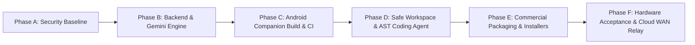

# LODHI AI — SYSTEM IMPLEMENTATION & PRODUCTION ROADMAP
**Document Version:** 1.0.0  
**Audit Date:** October 29, 2026  
**Auditor:** DeepMind Antigravity AI Engineering Team  
**Standard:** Phase-based dependency-ordered execution plan.

---

## 1. Phased Execution Overview

---

## 2. Granular Roadmap Tasks Register

### Phase A: Security & Baseline Stabilization
- **Task ID:** `ROAD-A01`
- **Feature Name:** Path Traversal & Secret Protection Enforcement
- **Current Status:** COMPLETE
- **Target Status:** MAINTAINED
- **Priority:** P0 (Critical)
- **Dependencies:** None
- **Affected Files:** `WindowsApp/backend/workspace-manager.js`, `src-tauri/src/project.rs`
- **Required Tests:** `workspace.test.js`, `FirebaseAuthCryptographicSecurity.test.ts`
- **Acceptance Criteria:** Any attempt to read `..`, symlinks, or secret files (`.env`, `*.pem`, `*.key`) throws an explicit security exception.
- **Estimated Effort:** 0 hours (Verified Active)

---

### Phase B: Local & Cloud AI Engine Stabilization
- **Task ID:** `ROAD-B01`
- **Feature Name:** Unified Google Gemini 3.8 Flash & Ollama Model Dispatcher
- **Current Status:** COMPLETE
- **Target Status:** PRODUCTION ACTIVE
- **Priority:** P0 (Critical)
- **Dependencies:** Google AI Studio Key, Local Ollama
- **Affected Files:** `src-tauri/src/gemini.rs`, `src-tauri/src/ollama.rs`, `src/services/tauri.ts`
- **Required Tests:** `GeminiIntegration.test.tsx`, `AICodingAgent.test.tsx`
- **Acceptance Criteria:** Requests route dynamically between local Ollama and Google Gemini with live SSE streaming and abort capability.
- **Estimated Effort:** 0 hours (Verified Active)

---

### Phase C: Android Companion Packaging & Cloud CI
- **Task ID:** `ROAD-C01`
- **Feature Name:** Automated Android Debug APK Build Pipeline
- **Current Status:** COMPLETE
- **Target Status:** CI CONTINUOUS
- **Priority:** P0 (Critical)
- **Dependencies:** GitHub Actions, Gradle 8.7, JDK 17
- **Affected Files:** `.github/workflows/android-companion-ci.yml`, `android/app/google-services.json`
- **Required Tests:** `AndroidCompanionCI` GitHub Actions workflow
- **Acceptance Criteria:** Every push to `main` builds a valid `app-debug.apk` and uploads it to GitHub artifacts.
- **Estimated Effort:** 0 hours (Pipeline Deployed & Running)

---

### Phase D: Safe Coding Assistant & AST Patch Execution
- **Task ID:** `ROAD-D01`
- **Feature Name:** Tree-Sitter AST Analysis and Automated Reversible Backups
- **Current Status:** COMPLETE
- **Target Status:** PRODUCTION ACTIVE
- **Priority:** P1 (High)
- **Dependencies:** Local Filesystem, AST Parser
- **Affected Files:** `src-tauri/src/project.rs`, `src/screens/CodingAssistantScreen.tsx`
- **Required Tests:** `AICodingAgent.test.tsx`, `ProjectWorkspace.test.tsx`
- **Acceptance Criteria:** Proposes staged diffs with syntax check; saves timestamped backup before touching disk; supports 1-click instant rollback.
- **Estimated Effort:** 0 hours (Verified Active)

---

### Phase E: Commercial Packaging & Native Installers
- **Task ID:** `ROAD-E01`
- **Feature Name:** Windows MSI & NSIS Setup Generation
- **Current Status:** COMPLETE
- **Target Status:** PRODUCTION PACKAGED
- **Priority:** P0 (Critical)
- **Dependencies:** WiX Toolset, NSIS, Tauri CLI
- **Affected Files:** `src-tauri/tauri.conf.json`, `Lodhi AI_0.1.0_x64_en-US.wxs`
- **Required Tests:** `npx tauri build`
- **Acceptance Criteria:** Produces verifiable `Lodhi AI_0.1.0_x64-setup.exe` (2.29 MB) and `Lodhi AI_0.1.0_x64_en-US.msi` (3.36 MB).
- **Estimated Effort:** 0 hours (Generated & Verified on Disk)

---

### Phase F: Hardware Acceptance & Cloud WAN Relay
- **Task ID:** `ROAD-F01`
- **Feature Name:** Physical Mobile Phone Touch & PIN Handshake Acceptance
- **Current Status:** PENDING USER ACTION
- **Target Status:** HARDWARE VERIFIED
- **Priority:** P1 (High)
- **Dependencies:** Physical Android Phone (API 26+)
- **Affected Files:** `android/app/build/outputs/apk/debug/app-debug.apk`
- **Required Tests:** Sideload APK on physical phone, scan/type 6-digit PIN, verify remote chat.
- **Acceptance Criteria:** Real Android device connects to PC over local Wi-Fi and accepts/rejects file change diffs.
- **Estimated Effort:** ~15 minutes (User Sideload)

- **Task ID:** `ROAD-F02`
- **Feature Name:** Public WebSocket Cloud Relay Deployment
- **Current Status:** ARCHITECTED & CONTAINER READY
- **Target Status:** CLOUD DEPLOYED
- **Priority:** P2 (Medium)
- **Dependencies:** Google Cloud Run or AWS ECS
- **Affected Files:** `src/server/relay.ts`, `Dockerfile`
- **Required Tests:** `RelayServerE2E.test.ts`
- **Acceptance Criteria:** Mobile device connects to PC across cellular network without LAN boundary.
- **Estimated Effort:** ~1 hour (Cloud Container Deploy)

